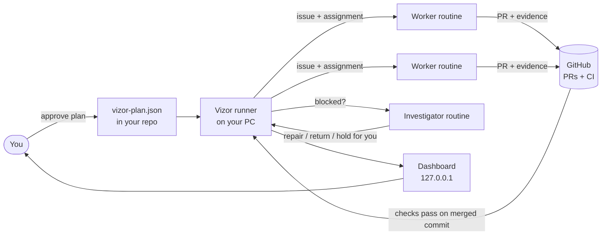

<p align="center">
  
</p>

<h1 align="center">Vizor</h1>

**You write the plan. Vizor runs the team.**

Vizor turns an approved project plan into GitHub issues, hands each one to a Claude Code agent, checks the result, merges it, and starts the next task. It keeps going after you close the dashboard, and it investigates on its own when an agent gets stuck.

You make the decisions only you can make. The agents do the rest.

---

## TL;DR

|                   |                                                                                                                                                                  |
| ----------------- | ---------------------------------------------------------------------------------------------------------------------------------------------------------------- |
| **What it is**    | A background runner, a CLI and a local web dashboard that coordinate a team of Claude Code agents on one GitHub repository.                                      |
| **What you do**   | Pick a repo, name your workers, choose how much freedom they get, approve the plan, and handle sign-ins and secrets.                                             |
| **What it does**  | Publishes the plan as issues, dispatches ready work in parallel, verifies checks on the exact merged commit, repairs failures, releases the next phase.          |
| **Where it runs** | Your Windows PC (signed in and on). The agents run as Claude Code routines in your Claude account. Nothing is hosted by Vizor.                                   |
| **Fastest setup** | Paste the [setup prompt](#set-it-up-with-claude-recommended) into Claude Code on your PC. It installs and configures everything and only asks you the decisions. |

## How it works



1. **Plan.** You approve a versioned plan: phases, tasks, dependencies, file scope and the checks that prove each task is done.
2. **Dispatch.** The runner publishes ready tasks as GitHub issues and starts one worker per task, in parallel where tasks don't overlap.
3. **Verify.** Code counts as done only when the plan's checks pass on the exact merged commit. Only then does dependent work start.
4. **Recover.** When a worker reports `blocked`, an investigator decides: route a repair, send the worker back with an answer, or hold it for you with a report.
5. **Watch.** The dashboard shows the queue, workers, PR checks and blockers. Closing it doesn't stop anything.

## You decide, the agents do

| You (leadership decisions)                                   | Vizor and its agents                                          |
| ------------------------------------------------------------ | ------------------------------------------------------------- |
| Which repository, and public or private                      | Install Node, Git, GitHub CLI and Vizor                       |
| How many workers and what to call them                       | Create labels, merge rules and the check workflow             |
| Autonomy level: Supervised, Standard or **braZy**            | Write the first plan from your goal and open it as a PR       |
| Approve the plan (merging its PR is the approval)            | Dispatch, review evidence, merge, repair, release next phases |
| Sign in to GitHub and Claude; paste routine secrets yourself | Run health checks and report back in plain language           |
| Anything involving money, credentials or outside commitments | Everything else inside the approved scope                     |

### Autonomy levels

| Level          | What happens                                                                                                                                                       |
| -------------- | ------------------------------------------------------------------------------------------------------------------------------------------------------------------ |
| **Supervised** | You approve everything. Workers open draft PRs; you accept and merge each one.                                                                                     |
| **Standard**   | Recommended to start. Results with evidence are accepted automatically; you merge PRs, or GitHub auto-merges once required checks pass.                            |
| **braZy**      | Full release inside the rails. Workers do their approved tasks without asking and merge their own PRs once every check passes. Failed checks get automatic repair. |

Every level keeps the same rails: approved scope only, secrets never leave `.vizor\secrets.json`, no force-pushes or skipped checks, and done means checks passed on the merged commit. braZy removes approval steps, not safety checks.

---

## Set it up with Claude (recommended)

**You need:** a Windows 10/11 PC you'll leave on and signed in, a GitHub account, and a Claude plan that includes Claude Code routines (Pro, Max, Team or Enterprise).

1. **Open Claude Code on that PC** (the Code tab in the Claude desktop app, or `claude` in PowerShell). It must be able to run commands on the PC.
2. **Copy the prompt below** (hover the block and click the copy icon) and paste it in.
3. **Answer the questions** it asks, sign in when a browser opens, and paste the routine secrets into the file it opens. That's your whole job.

<details open>
<summary><b>Setup prompt</b></summary>

```text
Set up Vizor (https://github.com/colinosbo/vizor) on this Windows PC and get it running for my project. You handle the whole setup. Only come to me for leadership decisions and for the things only I can do (sign-ins, secrets, approvals). Decide routine technical details yourself and tell me what you chose.

## Source of truth
1. Download the latest release package (not the source code):
   gh release download --repo colinosbo/vizor --pattern "vizor-*.zip" --dir "$env:TEMP\vizor-release" --clobber
   (If gh isn't installed or signed in yet, do step 1 and 2 of the checklist first, or download the vizor-<version>.zip asset from https://github.com/colinosbo/vizor/releases/latest.)
2. Extract it with Expand-Archive. Inside the vizor-<version> folder, read INSTALL.md (especially the "Agent setup" section) and runtime/skills/operator/vizor-setup/SKILL.md in full before doing anything else.
3. Follow "Agent setup" steps 0-10 in order, as wrapped by the vizor-setup skill. Prefer `vizor init` with every answer passed as flags. Those files win over this prompt if they disagree; tell me if they do.

## Ask me once, up front, in a single message (multiple choice where possible)
- Repository: an existing owner/repo, or a new one (name + public/private). Note: merge rails on a private repo need GitHub Pro, Team or Enterprise.
- Workers: how many and their names. Suggest a default (e.g. 2 workers: builder = Builder, reviewer = Reviewer).
- Autonomy: Supervised, Standard (recommended to start) or braZy. Explain each in one line.
- How you should work with me during setup: confirm each step, or run straight through and stop only for my items.
- What I want built first: a one- or two-sentence goal for the first plan.
- Permission to install anything missing (Node.js 24, Git, GitHub CLI, Claude Code CLI).
Pull everything else (GitHub login, default branch, folder location, ports) from the machine yourself. Don't ask me for it.

## Things only I do — tell me exactly when and how
- Complete browser sign-ins for GitHub (and Claude CLI if used).
- Create one Claude Code routine per worker plus one investigator routine at https://claude.ai/code/routines. Give me the exact name, prompt, trigger and repository settings for each from INSTALL.md step 6, one routine at a time.
- Paste each routine's Fire URL and token into .vizor\secrets.json myself, then reply "done".
- Review and merge the PRs you open (skills/config PR, first-plan PR). Merging is my approval.

## Ground rules
- Never ask me to paste tokens, Fire URLs or passwords into chat, and never print, log or copy them. Never commit .vizor/.
- Run every check in the checklist and compare against its "Expect" line. If something fails, diagnose and fix it yourself using INSTALL.md ("When the runner does not start" and the doctor fix table). Only escalate to me if the fix needs one of my items or a decision.
- Don't touch any other Vizor project, folder or scheduled task on this PC.
- Don't skip blocker investigation (`vizor investigator`). It's required.
- Don't mark the setup done until `vizor doctor --json` reports "healthy": true, `vizor health` shows a current scheduler heartbeat, and the first plan is published with tasks listed in `vizor status`.
- Clearly separate what you verified, what you assumed and what is still open.

## First plan
Using my goal, write .github/vizor-plan.json following FIRST-PLAN.md and the example in the package: small, independent tasks with clear acceptance criteria, file scope and named checks. Add a check workflow if the repo has none. Run `vizor check-plan`, then open the PR for me to merge.

## When you finish
Send me the short report from Agent setup step 10: repo, runner health, dashboard URL, autonomy level, workers, what's queued first, and any open items with the exact action I need to take. Then tell me the three commands I'll use day to day.
```

</details>

Want Claude to remember how to run Vizor later? Setup installs the operator skills (`vizor-setup`, `vizor-plan`, `vizor-operate`) into your Claude Code skills folder, so afterwards you can just say _"write a Vizor plan for …"_ or _"what is Vizor doing?"_.

## Set it up yourself

1. Download `vizor-<version>.zip` from [Releases](https://github.com/colinosbo/vizor/releases/latest) and extract it.
2. In the extracted folder: `node setup.mjs`. Open a new terminal.
3. In a clone of your project's repository: `vizor init`. It asks for the repo, workers and autonomy, opens `.vizor\secrets.json` for your routine credentials, then runs labels, investigator, skills, doctor and start.

Full guide: [packaging/INSTALL.md](packaging/INSTALL.md). First plan: [packaging/FIRST-PLAN.md](packaging/FIRST-PLAN.md), with a tested [example plan](packaging/examples/vizor-plan.json).

### Day to day

```powershell
vizor open      # dashboard
vizor status    # queue, workers, blockers
vizor health    # is the runner alive?
vizor doctor    # what's misconfigured, and how to fix it
```

## Requirements

- **Windows 10 or 11**, left on with your user signed in. The runner restarts on its own when you sign in. macOS and Linux can run the CLI, doctor and dashboard, but the runner only runs in an open terminal there.
- **Node.js 24**, **Git** and **GitHub CLI** signed in. The setup agent installs them.
- **GitHub** account with admin rights on the project repository (Vizor creates labels and merge rules).
- **Claude** plan that can create Claude Code routines: one per worker plus one investigator. Runs use your subscription usage and act as your GitHub account.
- Optional: **Claude Code CLI**, signed in, so a blocked worker gets the investigator's answer in the same chat.

## Status

Version 0.14.0. Install, upgrade, rollback, restart and sign-out recovery are verified live on Windows. Remaining release work, including the independent new-user rehearsal, is tracked in the [roadmap](docs/ROADMAP.md). Design decisions are in [AGENTS.md](AGENTS.md); how the runtime works is in [docs/automation-plan.md](docs/automation-plan.md) and the [runtime README](scripts/initiative-runtime/README.md).

## Development

Requires Node.js 24. The runtime has no npm dependencies; `npm install` only adds Prettier.

```sh
npm test               # runtime, lease and install-lifecycle tests
npm run format:check
npm run package        # dist/vizor-<version>.zip with a hash manifest
```

Releases are published by pushing a `v<version>` tag that matches `package.json`.

Project configuration, queue state, logs and credentials live in each project's `.vizor/` folder and the OS credential helper. Never commit them here.

## License

Rights reserved; not open source. See [LICENSE](LICENSE).
