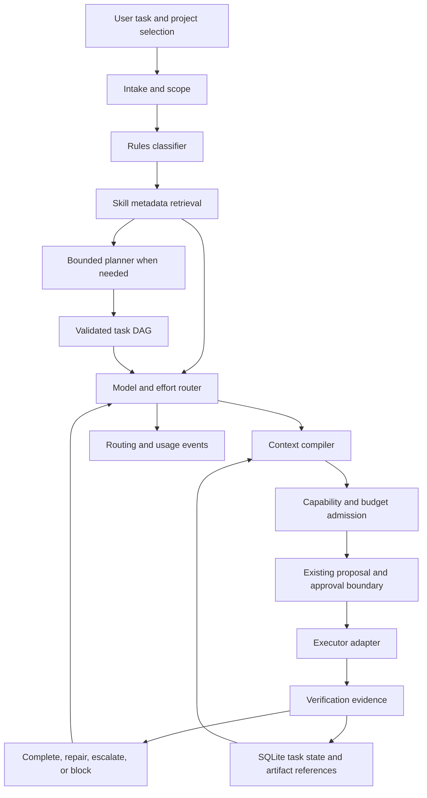

# Vizor intelligent orchestration architecture

Date: 2026-10-30
Status: Proposed architecture and implementation guidance; no runtime behavior is enabled by this document.
Decision: Extend Vizor's existing local control plane with skill-aware routing, structured task state, and measured context management. Start with route previews and preserve the existing execution boundaries.

## Objective and engineering guidelines

Optimize **cost per verified outcome**, subject to correctness, user control, latency, and spending limits. Token count alone is an incomplete objective: a smaller prompt that loses a constraint, or a cheap model that needs repeated repairs, can make the completed task more expensive.

Use these rules when implementing the next orchestration layer:

1. Default non-trivial implementation to balanced/medium. Use deterministic programs before models when a checked template or parser is sufficient.
2. Route individual tasks, not an entire project, to a capability tier. Model tier, reasoning effort, output allowance, and context allowance are separate decisions.
3. Skills externalize procedures. Their presence does not prove that a cheaper model can execute them correctly. Require compatible scope, strong checks, and measured evidence for downgrades.
4. Load metadata first, instructions on activation, and supporting material on demand. Enforce a total catalog budget as the library grows.
5. Count real verification failures, preserve evidence, and escalate after two consecutive failed repair cycles. Do not mistake provider outages or missing dependencies for reasoning failures.
6. Persist decisions and artifact references, not full conversations between agents. A successor must understand what was attempted and what remains unverified.
7. Keep permissions, spending, and model capability checks outside model-generated plans and skill instructions.
8. Ship changes behind explicit modes, with route explanations and regression evidence. Saving this design does not enable autopilot.

The detailed skill package format, selection algorithm, routing rules, and examples are in [Agent Skills and model routing](agent-skills-and-routing.md).

## Current implementation and gaps

This assessment is based on the repository at the date above, package version 0.10.2.

| Concern                     | Current owning source                                         | Extension                                                                                                                                                           |
| --------------------------- | ------------------------------------------------------------- | ------------------------------------------------------------------------------------------------------------------------------------------------------------------- |
| API provider abstraction    | `src/lib/providers/types.ts`, `openai.ts`, `anthropic.ts`     | Capability profiles; explicit effort; structured prompt blocks; cache and reasoning usage; opaque continuation items                                                |
| Model discovery             | `src/lib/providers/registry.ts`, provider adapters            | Account availability intersected with a versioned capability/price catalog; discovery does not establish supported effort values                                    |
| Orchestrator context        | `src/lib/server/orchestrator-context.ts`                      | Token-accounted manifests, activated skills, relevant project decisions; retain source/provenance                                                                   |
| Bounded orchestration       | `src/lib/server/orchestrator-stream.ts`                       | Route each bounded call; retain the current three-call ceiling until an explicit policy change                                                                      |
| Proposal approvals          | `src/lib/server/proposals.ts`, `orchestrator-tools.ts`        | Bind a proposal to a versioned plan, route constraints, skill digests, and artifact revision                                                                        |
| Spending protection         | `src/lib/server/budgets.ts`, `pricing.ts`                     | Per-workflow caps, new metering sources, cache-aware rates, reasoning limits; retain transactional reservations and conservative recovery                           |
| Persistent state            | `prisma/schema.prisma`, `src/lib/server/db.ts`                | Task graphs, attempts, verification evidence, skill locks, routing decisions, compact memory                                                                        |
| User-visible state          | `src/lib/server/events.ts`, `audit.ts`                        | Routing, skill loading, verification, and escalation events on existing owner-scoped channels                                                                       |
| Native terminal assignments | `src/lib/server/terminal-dispatches.ts`, `TERMINAL-AGENTS.md` | Initially provide an explicit skill/route recommendation with an approved task packet; model control and verification ingestion require a separate supported bridge |

The API orchestrator currently cannot execute code or inspect project files. API agents are conversations, not general coding workers. Native terminal process state does not establish task success. Native transcripts and CLI billing remain outside orchestrator visibility and API budget protection. These constraints determine the rollout order below.

## Component design

Keep the first version in the existing Next.js/Node application, with Prisma and SQLite. A local desktop application does not yet need a distributed queue, vector database, or orchestration microservices. Add an executor interface before adding another runtime.

Suggested new modules, introduced incrementally rather than as empty scaffolding:

```text
src/lib/orchestration/contracts.ts          Shared Zod schemas and inferred types
src/lib/orchestration/classify.ts           Pure task signals and classification
src/lib/orchestration/plan.ts               Bounded planner and DAG validation
src/lib/orchestration/route.ts              Pure eligibility and route ranking
src/lib/orchestration/context.ts            Manifest and prompt compilation
src/lib/orchestration/diagnostics.ts        Redaction and causal log extraction
src/lib/skills/registry.ts                  Discovery, snapshots and owner bindings
src/lib/skills/validate.ts                  Portable frontmatter and sidecar schemas
src/lib/skills/retrieve.ts                  Metadata search and compatibility filters
src/lib/skills/load.ts                      Bounded instruction/resource reads
src/lib/providers/capabilities.ts           Versioned model and effort profiles
src/lib/server/workflows.ts                 Persistence and transition admission
src/lib/server/task-executor.ts             Supported executor interface and leases
src/lib/server/task-verification.ts         Check registry and evidence ingestion
```

Keep pure routing/classification separate from filesystem/database services. Extend existing metering, proposals, authentication and event modules rather than creating competing implementations. Planner calls and registry embedding work must use metering with explicit source labels when introduced.



The loop is a proposed control flow for an authorized workflow, not a background loop enabled in this release. In preview mode it stops before execution. Under today's manual policy, escalation prepares a new proposal; it does not automatically send another assignment.

| Component            | Responsibility                                                                                  | Must not do                                                           |
| -------------------- | ----------------------------------------------------------------------------------------------- | --------------------------------------------------------------------- |
| Intake               | Normalize request; bind owner, project, repository revision, constraints, and execution policy  | Infer deployment authorization from a coding request                  |
| Classifier           | Determine domain, ambiguity, coupling, verification availability, impact, candidate task shape  | Assign low tier merely because a filename ends in `.json`             |
| Skill registry       | Discover, validate, index, lock, and selectively read packages                                  | Execute installation hooks or trust a package's self-declared quality |
| Planner              | Emit task nodes, dependency edges, input/output contracts, and checks                           | Spawn workers or grant tools                                          |
| Router               | Select an eligible model/effort/context combination with reasons and a fallback policy          | Mutate an agent's saved default model to implement one task's route   |
| Context compiler     | Compile bounded, provenance-aware prompt segments and resource references                       | Concatenate all histories or silently discard required rules          |
| Admission controller | Enforce ownership, capabilities, execution policy, context fit, and transactional cost ceilings | Lower quality floors to fit an unaffordable route                     |
| Scheduler/executor   | Claim ready tasks, enforce leases and resource locks, invoke supported adapters                 | Treat a DAG edge as permission or replay uncertain effects            |
| Verifier             | Run registered checks against a specific artifact revision and record evidence                  | Accept a model's claim that tests passed                              |
| State engine         | Persist transitions, decisions, revisions, and result contracts                                 | Treat `todo.md` as a concurrent database                              |
| Observability        | Explain decisions and aggregate usage and quality                                               | Store credentials or private chain-of-thought                         |

## Classification and planning

Start with deterministic signals from available inputs: task language, explicitly supplied paths, file counts, requested runtime changes, known templates, dependency fan-out, and available verification. Do not assume project inspection exists; use a supplied project snapshot or an authorized executor to obtain one.

Classify into `mechanical`, `implementation`, `architecture`, `diagnosis`, and `operations`, alongside independent impact and ambiguity fields. A resource JSON change with economic/gameplay consequences can have high impact even if generation is mechanical.

For clear boilerplate, bypass planning and produce one checked node. For ordinary implementation, start balanced/medium. For unknown scope or a large goal, allow one bounded balanced planner call; high architecture planning is appropriate when cross-cutting invariants justify it. A cheap classifier is optional only after a labeled evaluation shows useful savings; a paid classifier on every small task can cost more than it saves.

Retrieve skills once provisionally, plan, then retrieve per node and recompute requirements. Validate planner output with Zod: bounded node/edge counts, known check IDs, valid artifact references, no cycles, no dangling dependencies, explicit owners/write sets, and a workflow budget. Limit re-planning; do not recursively generate plans without a stop condition.

Suggested initial limits, configurable and subject to measurement: 24 nodes per plan, 4 composed skills per node, 3 executor workers, one integration writer per repository/worktree, one planner call, and one clarification/replan pass. These are design defaults, not observed capacity claims.

## Shared internal contracts

The following TypeScript is an interface sketch, not an installed API:

```ts
type Tier = "low" | "medium" | "high";
type Effort = "low" | "medium" | "high" | "xhigh";
type TaskStatus =
  | "draft"
  | "awaiting_approval"
  | "ready"
  | "running"
  | "verifying"
  | "repair_pending"
  | "escalation_pending"
  | "blocked"
  | "succeeded"
  | "failed"
  | "cancelled"
  | "recovery_required";

interface TaskSpec {
  id: string;
  ownerId: string;
  workflowId: string;
  projectId: string;
  revision: number;
  goal: string;
  acceptanceCriteria: string[];
  kind:
    | "mechanical"
    | "implementation"
    | "architecture"
    | "diagnosis"
    | "operations";
  complexity: Tier;
  ambiguity: "low" | "medium" | "high";
  impact: "low" | "medium" | "high";
  dependsOn: string[];
  inputArtifacts: string[];
  outputArtifacts: string[];
  writePaths: string[];
  checkIds: string[];
  skillLocks: { id: string; digest: string; profileDigest: string }[];
  baseCommit?: string;
  executionPolicyId: string;
  maxAttempts: number;
  maxCostMicros?: string; // Integer serialized as a decimal string.
}

interface RouteDecision {
  id: string;
  taskId: string;
  taskRevision: number;
  provider: string;
  modelId: string;
  tier: Tier;
  requestedEffort: Effort;
  effectiveEffort: string | null;
  effortControl: "native" | "provider-default";
  maxOutputTokens: number;
  maxContextTokens: number;
  reasonCodes: string[];
  capabilityCatalogVersion: string;
  priceVersion: string;
  policyVersion: string;
  contextManifestDigest: string;
  maxQuotedMicros?: string;
  expiresAt: string;
}

interface VerificationResult {
  id: string;
  attemptId: string;
  checkId: string;
  artifactDigest: string;
  environmentDigest: string;
  status: "passed" | "failed" | "inconclusive" | "not_run";
  category?: "implementation" | "environment" | "provider" | "authorization";
  exitCode?: number;
  evidenceRefs: string[];
  diagnosticFingerprint?: string;
}

interface OrchestrationServices {
  classify(input: unknown): Promise<unknown>;
  retrieveSkills(task: TaskSpec): Promise<unknown>;
  plan(input: unknown): Promise<TaskSpec[]>;
  route(task: TaskSpec): Promise<RouteDecision>;
  compile(task: TaskSpec, route: RouteDecision): Promise<unknown>;
  admit(task: TaskSpec, route: RouteDecision): Promise<unknown>;
  propose(
    task: TaskSpec,
    route: RouteDecision,
  ): Promise<{ proposalId: string }>;
  verify(attemptId: string): Promise<VerificationResult[]>;
  checkpoint(taskId: string, expectedRevision: number): Promise<void>;
}
```

Replace sketch `unknown` types with separate Zod-validated request/result types during implementation. Pass immutable records or IDs between layers; do not let each component independently edit a shared prompt string. Every read and transition must bind the authenticated owner and project. Project IDs and skill package IDs are not authorization tokens.

## Context and token management

Compile a manifest before serializing a provider request. Record each segment's source, digest, trust level, estimated/measured token count, priority, and whether it is mandatory. Use provider counting on the final compatible request before budget reservation, following the existing protected-call path.

Recommended stability order:

1. Stable capabilities and deterministically ordered tool definitions.
2. Application instructions and host permission rules.
3. Applicable project/repository rules, with their paths and revision.
4. Bounded skill metadata catalog, pinned for the task/session.
5. Active skill instructions, stable for the task's attempt lineage.
6. Relevant durable decisions and dependency result contracts.
7. Current user request, scoped files/diffs, and compact diagnostics.

This is a logical ordering. Provider adapters must serialize it using the provider's actual message and cache hierarchy. Claude caches in tools → system → messages order; OpenAI supports automatic prefix caching. Exact cache behavior, thresholds, lifetime, and discounts vary by provider/model. Treat savings as measured usage, not a promised 90% reduction. See [Claude caching](https://platform.claude.com/docs/en/build-with-claude/prompt-caching) and [OpenAI caching](https://developers.openai.com/api/docs/guides/prompt-caching).

Preserve stable prefixes within an attempt lineage; append task deltas instead of rebuilding catalogs every turn. Do not pad prompts to chase cache hits, retain stale project rules for a hit, or put timestamps and changing task status in the static prefix. Rebuild context at a recorded checkpoint when constraints, skills, or relevant sources change. A full conversation cannot remain append-only indefinitely.

Budget equation:

```text
mandatory instructions + selected catalog + active skills + retrieved references
+ task evidence + tool schemas + history + reserved completion/reasoning space
+ safety headroom <= selected model context window
```

Completion and reasoning accounting must follow each model's actual limits; some providers include reasoning within completion counts. Do not subtract or charge it twice. A first profile might target 12k input for mechanical nodes, 32k for implementation, and 64k for diagnosis, but use observed task requirements and actual supported windows. A high tier does not require a huge prompt.

When over budget, remove duplicate/obsolete evidence, then low-value history, then optional references/catalog entries. Split the node or select an eligible larger-context model if mandatory content still does not fit. Record omitted sources. Never silently truncate acceptance criteria, applicable instructions, or the only root-cause evidence.

### Log triage

Keep raw logs in local artifacts with retention limits. Before any model receives a log, strip terminal escape sequences and redact known credentials and sensitive values; retain a reference to the artifact. Regex rules are the first pass, followed by stack/diagnostic block extraction and deterministic ranking.

Extract command and exit code; Gradle failing task and `What went wrong`; compiler diagnostics including source/caret context; exception type, `Caused by`, suppressed exceptions, and relevant application frames; Mixin target/method descriptors; crash/environment identifiers; and test failures. Deduplicate recurring blocks. Start with 20–30 useful lines plus omission counts, but allow an explicit bounded expansion if causal context is missing. Some relevant records are INFO lines; log level alone must not decide relevance.

Scrubbing can hide evidence or miss an unknown secret. Keep provenance, bounded excerpt retrieval, and a structured `diagnostic_incomplete` signal so the agent can request more before concluding. Do not feed an entire crash report to every worker.

## State, coordination, and recovery

Use SQLite as the authoritative state store. Export `tasks/todo.md` as a readable derived view after committed transitions; never require agents to coordinate by overwriting one Markdown file.

Add `Workflow`, `Task`, `TaskDependency`, `TaskAttempt`, `Verification`, `Artifact`, `RouteDecision`, `SkillPackage`, `SkillLock`, `SkillOutcome`, `MemoryEntry`, and `ExecutionPolicy`. Each owner-scoped entity needs a revision or immutable version. Use unique `(taskId, attemptNumber)`, `(attemptId, checkId, artifactDigest)`, and `(workflowId, idempotencyKey)` constraints where appropriate. Reject dependency cycles before insertion. Keep artifacts on disk with canonical paths, digests, size limits, and database references; do not store huge logs in database rows.

Transitions follow this outline:

```text
draft -> awaiting_approval -> ready -> running -> verifying -> succeeded
                                            verifying -> repair_pending
                                            verifying -> escalation_pending
                                            verifying -> blocked/failed
repair_pending/escalation_pending -> awaiting_approval (current policy)
any non-final state -> cancelled
interrupted execution -> recovery_required
```

Claim work transactionally with a lease, optimistic revision check, and fencing token. A lease expiring does not prove that a subprocess stopped. Recovery must reconcile or stop the previous executor before another writer starts. Use compare-and-set transitions so duplicate SSE delivery or UI retries do not start duplicate work.

Separate inference, tools, and external effects in the attempt journal. Do not replay an uncertain send, merge, deployment, or server change. Retain conservative spend accounting when usage is incomplete. Bind successful checks to the produced artifact digest and environment; a check against an earlier revision cannot complete a new revision.

### Memory

Ephemeral records include repair diagnostics, temporary excerpts, and intermediate diffs. Expire them after resolution plus a configurable debugging window. Durable records include approved architectural decisions, stable item IDs, compatibility constraints, repository conventions, and verified reusable outcomes.

Persist durable entries with owner/project scope, source artifacts, confidence, created/verified dates, relevant file/commit hashes, and supersession links. A model may propose memory; it cannot turn its own unsupported conclusion into a project rule. Retrieve on demand, detect stale sources, and distinguish verified facts from user decisions. Do not reuse performance evidence across unrelated Minecraft versions or dependency environments.

## Fan-out example: a magic-system mod

First obtain the actual game version, loader, mappings, runtime/toolchain, multiplayer requirements, and acceptance criteria. Java 21 and a particular Fabric/Paper version are examples, not universal defaults.

| Node | Depends on       | Skill/task                                                            | Initial route                                      | Verification                                    |
| ---- | ---------------- | --------------------------------------------------------------------- | -------------------------------------------------- | ----------------------------------------------- |
| A    | Project snapshot | Define spell IDs, state ownership, serialization and packet contracts | Balanced/medium; high if invariants are unresolved | Contract review, explicit version assumptions   |
| B    | A                | Generate recipes/lang/models/blockstates in isolated paths            | Deterministic generator or evaluated low/low       | Schema/reference checks and resource loading    |
| C    | A                | Implement spell registry and cooldown/mana logic                      | Balanced/medium                                    | Unit/integration checks                         |
| D    | A                | Implement networking and server authority                             | Balanced/high or high/high for packet uncertainty  | Malformed packet, authority, concurrency checks |
| E    | B, C, D          | Integrate, build, launch disposable test server/client                | Balanced/medium; escalate on evidence              | Gradle, startup and multiplayer behavior        |
| F    | E                | Review system invariants and summarize evidence                       | High only if risk/coupling justifies it            | Acceptance criteria and evidence review         |

Parallelize B/C/D only after A's contracts are accepted, with distinct write sets or worktrees. Batch tiny resource files into one node; one agent per file wastes setup and context. Shared registry/build-file changes belong to the integration owner. Each worker receives the contract, relevant skill, scoped files, and checks; it does not receive sibling transcripts. Review the integrated revision again after merging work.

Concurrency admission is the minimum of configured worker count, provider limits, resource locks, available execution adapters, and budget headroom. Include expected integration and escalation costs in the workflow envelope. The current eight-terminal limit is not a recommendation to run eight overlapping coding tasks.

## Tools, MCP, and native CLI boundaries

A skill is procedural knowledge; a tool supplies capability; a host policy supplies permission. Requested tools must resolve to registered tool IDs and scopes. Effective access is the intersection of host policy, owner authorization, executor capability, and the task's approved tool set. Skill frontmatter cannot add permissions.

Discover MCP connectivity through the tool layer, not a skill's claim that a service exists. Pass only needed tool schemas; sort stable sets deterministically. Tool and reference outputs remain untrusted data. A repository skill may teach Gradle triage but does not authorize downloading arbitrary scripts, changing a production server, or exposing credentials.

For native CLIs, start with visible task packets containing skill digest/path, desired route, constraints, and result requirements. Mark model/effort as `recommended` unless a supported bridge confirms the effective settings. Do not type hidden model-switch commands, read native history, bypass native permission prompts, or report fabricated token costs. Automatic verification/escalation needs a later structured result bridge or a dedicated executor; a terminal's exit code is not a Gradle verification report.

## API and user interface

Proposed owner-scoped endpoints under the existing authenticated API router:

| Endpoint                               | Contract                                                                                                                                  |
| -------------------------------------- | ----------------------------------------------------------------------------------------------------------------------------------------- |
| `GET /api/skills?projectId=...`        | Bounded metadata, provenance, trust and compatibility; no full bodies by default                                                          |
| `GET /api/skills/:id/versions/:digest` | Explicit instruction load with size/path checks                                                                                           |
| `POST /api/skills/preview-import`      | Validate a local package and show changes/permissions; never execute scripts                                                              |
| `POST /api/workflows/preview`          | Classify, retrieve, and return a proposed DAG and route explanations; deterministic unless a bounded paid planner is explicitly requested |
| `POST /api/workflows`                  | Save a validated plan with an idempotency key and expected project revision                                                               |
| `POST /api/tasks/:id/route-preview`    | Return candidates, exclusions, effective effort, context size and estimate                                                                |
| `POST /api/tasks/:id/propose`          | Create a version-bound existing-style proposal; execution follows current approvals                                                       |
| `POST /api/tasks/:id/cancel`           | Cancel pending execution and signal an active supported executor                                                                          |
| `GET /api/workflows/:id`               | Snapshot with tasks, evidence, spending and unresolved conditions                                                                         |

Keep skill content, artifacts, and workspaces owner-scoped; reject arbitrary path traversal and cross-project lookup. Mutations require existing origin/session checks and validated inputs. References to paid planning must be clear before calling a provider. Use existing SSE for owner-scoped changes, with sequence IDs and snapshot recovery.

Show a compact task card: **Balanced · Medium effort · 2 skills · Checks pending**. Expand it to see why that route was selected, which skills were pinned, maximum quote versus actual usage, and what would trigger escalation. Use `estimated`, `unavailable`, and `recommended` labels accurately. When escalation is pending, explain the two failed checks and preserve access to the previous attempt. Avoid exposing implementation vocabulary in the normal task flow.

## Observability and accounting

Emit structured events including `task.classified`, `skill.candidates`, `skill.activated`, `skill.resource_loaded`, `route.selected`, `route.rejected`, `context.compiled`, `verification.completed`, `task.escalation_requested`, `task.escalated`, `task.recovery_required`, and `budget.blocked`.

Record workflow/task/attempt/route IDs; policy and catalog versions; skill versions/digests; reason codes; requested/effective effort; model; context segment token counts; cache usage; total and reasoning token breakdowns; quoted/settled costs; tool duration; checks and diagnostic fingerprints; wall-clock time and user intervention. Exclude secrets, raw chain-of-thought, and full source contents from default event payloads.

Primary metrics are total cost per verified task, first-attempt pass rate, final pass rate, quality regressions, escalation rate, cost of unsuccessful attempts, time to verified completion, and stale/unsupported routes. Break these down by skill digest × task class × model/effort × environment. Cache hit rate and token reduction are secondary metrics; compare matched tasks rather than unrelated workloads.

Extend the ledger before activating caching or effort controls. Today's two-rate pricing and two-token usage shape are insufficient for cache-write/read categories. Reserve conservatively for the maximum applicable input category, including cache writes, plus completion/reasoning allowance. Never reserve as if a cache hit were guaranteed. Account for provider-reported categories without double counting reasoning included in output. Pin price snapshots and retain unknown-usage behavior. See the companion routing document for normalized usage.

## Alternatives and trade-offs

| Decision                                     | Selected direction                                                    | Trade-off                                                              |
| -------------------------------------------- | --------------------------------------------------------------------- | ---------------------------------------------------------------------- |
| Agent chooses everything vs server policy    | Server validates and admits every route and task transition           | More explicit schemas; reproducible cost/permission boundaries         |
| All skills in context vs progressive loading | Metadata discovery and bounded activation                             | Requires retrieval quality and context manifests                       |
| Always cheapest vs quality-constrained cost  | Cheapest eligible route with verified success evidence                | Requires outcome measurement; avoids repeated false economy            |
| Full autonomy now vs staged execution        | Preview, proposals, then separately authorized bounded execution      | Slower rollout; preserves current product guarantees                   |
| Vector search now vs lexical index           | SQLite metadata/FTS first, embeddings after measured retrieval misses | Less semantic recall initially; fewer dependencies and embedding calls |
| Markdown task state vs transactional state   | SQLite authority, Markdown export                                     | Additional tables; safe concurrency and restart handling               |

## Implementation sequence and acceptance gates

### 1. Foundations and shadow routing

Add strict capability/price profiles and route reason codes. Extend provider request types for explicit effort, cache hints, and opaque continuation handling; preserve behavior for old agents and templates. Create task/attempt/route records with migrations and backups through existing setup. Add a pure deterministic router that records what it would do without switching models or sending additional calls.

Acceptance: unsupported effort never reaches a provider; a route uses only available/account-authorized models; protected requests with unknown prices remain blocked; no automatic agent-setting changes; existing proposal, startup, terminal, budget and provider tests remain valid.

### 2. Registry and progressive context

Implement local package validation, project bindings, digest locks, metadata search, activation and explicit resource reads. Add manifests, cache serialization, category-aware accounting, and bounded log extraction. Introduce a small fixture library for the Minecraft categories in the companion document; version-agnostic templates must demand actual project versions.

Acceptance: inactive bodies/resources never enter prompts; oversized catalogs stay bounded; traversal/symlink escapes and malformed YAML are rejected; skill updates do not alter locked tasks; cache usage settles correctly without inflated totals; required constraints survive compaction.

### 3. Proposal integration and evidence

Expose previews and route explanations. Bind proposals to task/route/skill revisions. Produce native assignment packets with requested versus confirmed settings. Add trusted verification records only for supported execution paths; manual/imported evidence carries its provenance and cannot silently become measured router success.

Acceptance: stale approval cannot execute a different task, model ceiling, skill version, or source revision; duplicate requests do not duplicate assignments; terminal usage stays separate; uncertain outcomes require reconciliation.

### 4. Bounded execution, repair, and escalation

Implement a supported executor and verifier, resource locks, fencing, cancellation and restart recovery. Automatic retries are allowed only inside a separately adopted, explicit execution policy with attempt, cost, tool, model and effect boundaries. Default remains today's manual approvals. Add failure categorization and the two-failure escalation rule.

Acceptance: duplicate checks do not increment the streak; two failed repair cycles escalate once; environment/provider failures do not trigger capability escalation; high-tier exhaustion stops; no unaffordable fallback bypasses budgets; crash recovery does not replay uncertain effects.

### 5. Evidence-based optimization

Build a frozen evaluation set spanning resource generation, Java logic, packet faults, Mixin failures and server operations, with checked acceptance criteria. Start with shadow comparisons; enable low-tier downgrades per validated cohort. Add vector retrieval only when catalog search misses justify its cost. Keep rollback flags and champion/challenger results by policy version.

Acceptance: agreed quality targets hold on held-out tasks, cost per verified outcome improves against balanced/medium, and latency and intervention remain acceptable. Do not announce a savings percentage before measuring it.

## Recommended next implementation slice

Build capability profiles, the pure route-preview engine, and the metadata-only local skill registry first. They provide reviewable routing decisions without requiring an autonomous coding runtime. Follow with context/usage accounting before live cache optimization, then proposal integration and real verification. An executor should be added only after its permission, recovery and result contracts are implemented.
